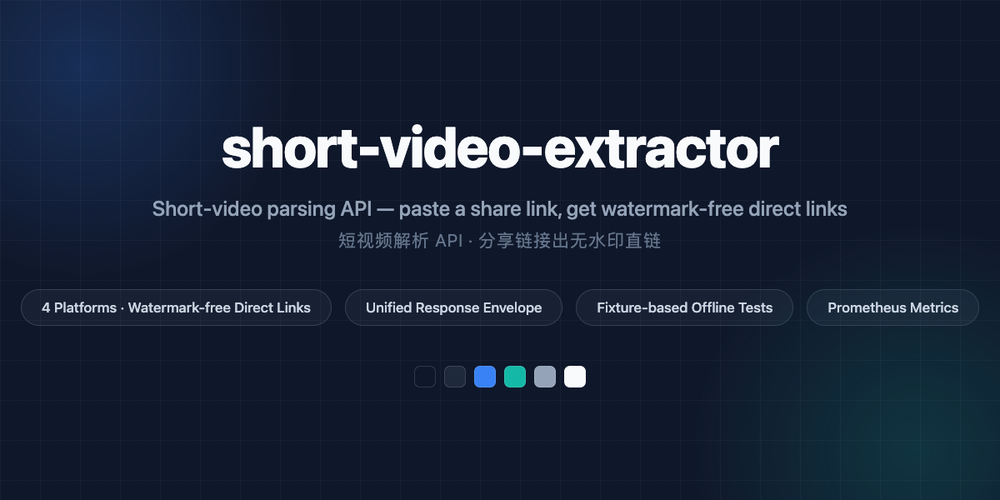

<div align="center">



# short-video-extractor

**[简体中文](README.md) | [English](README.en.md)**

> [!WARNING]
> 该项目正在重构整改，接口与行为可能随时调整，接入前请先确认最新实现。

*短视频解析 API：给一条分享链接，返回无水印视频 / 图集直链。*

[](https://github.com/hey-yx/short-video-extractor/actions/workflows/test.yml)
[](https://bun.sh)
[](https://www.typescriptlang.org)
[](LICENSE)

[架构](#架构) • [平台状态](#平台状态) • [API](#api) • [可观测性](#可观测性) • [本地开发](#本地开发) • [环境变量](#环境变量) • [部署](#部署) • [CI](#ci) • [设计文档](#设计文档)

</div>

短视频解析 API：给一条分享链接，返回无水印视频 / 图集直链。v2.1 现支持 9 个平台：抖音、小红书、快手、B 站、微博、X/Twitter、YouTube、Instagram Reels、TikTok。默认返回直链（客户端请求时不带 Referer 即可下载），服务器零带宽；`/media` 中转作为可选增强。

## 架构

请求流程：**match（识别平台）→ 缓存 → dispatch（短链展开）→ fetch（平台适配层）→ parse（纯函数）→ 统一信封返回**。

```
src/
├── index.ts                  # 入口
├── bootstrap/{app,server}.ts # createApp()（测试可直接调）、监听与优雅关闭
├── routes/
│   ├── parse.routes.ts       # POST|GET /parse（限流、缓存、指标打点）
│   ├── media.routes.ts       # GET|HEAD /media（可选流式中转）
│   └── ops.routes.ts         # /health /ready /platforms /metrics
├── services/
│   ├── parse.service.ts      # 编排：match → 缓存 → dispatch → fetch → parse
│   ├── cache.ts              # LRU + expiresAt 语义 + 负缓存 + singleflight
│   ├── limiter.ts            # 按 IP 令牌桶限流
│   └── media-proxy.ts        # HMAC 签名 + SSRF 白名单 + 手动跟 302 + Range 透传
├── platforms/                # 插件式平台层：加平台 = 加目录 + app.ts 注册一行
│   ├── douyin/  xhs/  kuaishou/  bilibili/  weibo/  twitter/  youtube/  instagram/  tiktok/
│   └── registry.ts  hosts.ts
├── core/                     # 错误码、统一信封、URL 工具
├── infra/                    # pino 日志、指标、Puppeteer 浏览器网关
└── types/platform.ts         # 统一数据模型（MediaAsset / ParseResult / FetchCtx）
```

平台层三条硬约束：`platforms/**` 不 import Elysia、不读 env、不 console.log；`parse()` 是纯函数（同输入同输出），用 fixture 离线回归；IO 只经 `fetch()` 和注入的 `FetchCtx`。平台改版时表现是「单测先红」，不是线上悄悄返回空结果。

技术栈：Bun + Elysia。运行时依赖只有 elysia、@elysiajs/cors、lru-cache、pino、puppeteer（仅浏览器兜底路径需要：抖音风控降级、小红书降级兜底；纯 HTTP 主通道零浏览器依赖）。

## 稳定性

- **抖音双通道**：默认纯 HTTP（L1 零签名 detail 接口）；一旦 403 `ArgusSecurityPlugin`（L1 被风控），自动降级浏览器——打开作品页并从 response 事件截取页面自己发出的 `/aweme/v1/web/aweme/detail/` XHR JSON，`via` 字段如实标 `browser`。降级计数见 `channel_downgrade_total`。
- **瞬态重试**：`UPSTREAM_TIMEOUT` / `UPSTREAM_ERROR`（网络层与上游 5xx）在编排层重试 1 次，指数退避（500ms→1s），总耗时受请求 15s 上限约束；`RISK_CONTROL`、内容类与参数类错误一律不重试（重试风控=加重风控）。计数见 `parse_retry_total`。
- **浏览器并发闸**：所有浏览器通道共享一个信号量，最多 2 个并发 page，超出的排队，排队期间随请求取消（AbortSignal）立即退出——防止并发打满内存（Chrome 每页约 30–110 MB）。
- **风控如实分类**：小红书 `error_code=300012`（IP at risk）等错误页归 `RISK_CONTROL`（503，带可读文案），不冒充改版。

## 平台状态

9 个平台全部接入统一 `ParseResult` 信封；通道与能力以各 adapter 的 `capabilities` 声明 + `docs/research/` 实测记录为准：

| 平台 | 通道 | 支持内容 | 清晰度档位 | 直链绑 IP |
|---|---|---|---|---|
| 抖音 | HTTP 主通道（零签名 detail 接口 + play 直链），L1 被风控时自动降级浏览器截 detail XHR | 视频、图集、实况照片 | 540p/720p/1080p/原片四档（另附 720p 水印档） | 否（play 直链空 Referer 可下） |
| 小红书 | 纯 HTTP 主通道（请求头三件套放行，见下）+ 风控/登录墙自动降级浏览器兜底 | 笔记视频、图集图片 | 视频出 master 流（h264 优先）；图片原图 | 否 |
| 快手 | 纯 HTTP（短链 302 取 photoId + 移动端分享页 INIT_STATE，零 cookie） | 视频、图集 | 服务端返回的全部分辨率（按高度排序，最高档为主 URL） | 否 |
| B 站 | 纯 HTTP（view + playurl try_look=1） | 视频（多 P 逐个出 asset）、DASH 音视频分离 | 360P–4K 按 DASH id 映射（120=4K、116=1080P60、80=1080P…） | 否 |
| 微博 | 纯 HTTP（statuses/show 匿名 JSON；视频直链页 fid 换 mid；t.cn 短链 302 展开） | 视频、图集 | 1080P/720P/480P 等服务端给的档位（component 档位比 show 全） | 否 |
| X/Twitter | 纯 HTTP（cdn.syndication.twimg.com/tweet-result，token=0 免签名） | 单条推文视频、GIF、图集 | mp4 按 bitrate 多档 + HLS 备选 | 否（twimg 直链不校验出口 IP） |
| YouTube / Shorts | 纯 API（innertube /player，ANDROID_VR→IOS 失败自动换 client，免 PO Token 免 cookie） | 视频、Shorts | 144p–2160p 按源返回（ANDROID_VR 可到 4K），DASH 音视频分离 + 合并档 | **是**（googlevideo 直链绑解析出口 IP，约 6h 过期，直链须经 `/media` 服务端中转，中转与解析走同一代理出口） |
| Instagram Reels | 纯 HTTP（匿名 GraphQL `doc_id` 口子，免登录免 cookie，需配 `IG_GRAPHQL_DOC_ID`） | Reels、Post、IGTV 视频、图文图集 | mp4 按源返回 | 否（fbcdn 直链无 ip= 绑定） |
| TikTok | 纯 HTTP（tikwm 公开接口：无水印直链/图集/音乐；解析出站走代理） | 视频、图集、音乐 | 无水印 play/hdplay 双档 | 否（tiktokcdn 直链不绑 IP） |

代理：国内平台直连不走代理；海外平台（YouTube 等）经 `PROXY_<PLATFORM>` / `OUTBOUND_PROXY` / `HTTPS_PROXY` 出站代理（见[环境变量](#环境变量)）。


## API

所有 JSON 响应走统一信封：

```json
{ "success": true, "data": { ... } }
{ "success": false, "data": null, "error": { "code": "RISK_CONTROL", "message": "..." } }
```

### POST /parse（或 GET /parse?url=）

主接口。`Content-Type: application/json`，body `{"url": "<分享链接>"}`。支持分享短链（v.douyin.com、xhslink.com、v.kuaishou.com、b23.tv、t.cn、youtu.be 等，自动展开）。

`data`（ParseResult）核心字段：

| 字段 | 说明 |
|---|---|
| `platform` / `id` / `kind` | 平台、平台内 ID、`video` \| `album` |
| `title` / `description` / `tags` / `author` | 元数据 |
| `assets[]` | 资源列表，见下 |
| `expiresAt` | 所有直链里最早过期的时刻（Unix 秒），缓存与重取依据 |
| `via` | 解析通道：`http` 或 `browser`（取数语义，全平台统一） |

`assets[]`（MediaAsset）：`type`（video/image/audio/cover）、`url`（**直连地址**，客户端请求时不要带 Referer；YouTube 除外——googlevideo 直链绑解析出口 IP，必须经 `/media` 服务端中转下载）、`variants[]`（同资源的其他档位，抖音给全四档）、`width` / `height` / `durationMs` / `size`、`backups[]`（备用 CDN）、`liveClipUrl`（实况照片的 5s 视频）。B 站与 YouTube 视频另带 `audioUrl`（DASH 音轨，需与视频分别拉取后合成）。

错误码与 HTTP 状态：`INVALID_URL`(400)、`UNSUPPORTED_PLATFORM`(422)、`CONTENT_NOT_FOUND`(404)、`CONTENT_RESTRICTED`(403)、`RISK_CONTROL`(503)、`UPSTREAM_ERROR` / `UPSTREAM_CHANGED`(502)、`UPSTREAM_TIMEOUT`(504)、`RATE_LIMITED`(429)、`MEDIA_*`（见下）、`INTERNAL`(500)。

### GET /media?u=&exp=&sig=（可选，默认关闭）

流式中转，三种用途：强制下载文件名（Content-Disposition）、兜底会强制带 Referer 的容器（微信内置浏览器等）、链接过期后透明重取。

> [!NOTE]
> 配置 `PROXY_SECRET` 后启用（未配置返回 501，直链主路径不受影响）。

- `sig` = HMAC-SHA256(`PROXY_SECRET`, `"<url>\n<exp>"`) 前 32 位十六进制，有效期 600 秒；过期 410、篡改 403。
- 上游域名白名单（平台分享域 + CDN 域），302 每跳重新校验（SSRF 防护）；并发上限 2；支持 Range / HEAD。

### GET /health

存活探针：进程活着即 200 `{"status":"ok","uptime":...}`，不查外部依赖（防外部抖动引发连环重启）。Docker HEALTHCHECK 打这里。

### GET /ready

就绪探针：平台适配器注册齐才 200，否则 503。

### GET /platforms

已注册平台自描述（名称、说明、识别的域名、能力声明）。

### GET /metrics

Prometheus 文本格式（自写渲染，未引 prom-client）：

| 指标 | 类型 | 说明 |
|---|---|---|
| `parse_total{platform,code}` | counter | 解析计数，code 为 `ok` 或业务错误码 |
| `parse_duration_ms` | histogram | 解析耗时分布（毫秒，按 platform） |
| `cache_hit_total` | counter | 缓存命中次数 |
| `upstream_error_total{platform,reason}` | counter | 上游失败/风控次数 |
| `channel_downgrade_total{platform,from,to}` | counter | 解析通道自动降级次数（抖音/小红书 http→browser） |
| `parse_retry_total{platform}` | counter | 瞬态错误（超时/5xx）重试次数 |

## 可观测性

- **结构化日志**：pino，一行一请求 JSON。每请求生成/透传 `x-request-id`（响应头回写，日志字段 `reqId`），访问日志含 method、path、status、耗时，平台解析事件另带 platform / id / 耗时。
- **敏感信息脱敏**：所有日志输出经深度 redact——URL 的 query 值整体打码（防 `xsec_token` 等凭据进日志），消息文本里的内联链接同样处理，Error 实例与 detail 递归脱敏。参数名保留，值一律 `REDACTED`。
- 日志级别由 `LOG_LEVEL` 控制（默认 `info`）。

## 本地开发

```bash
bun install
bun dev          # 开发（--watch），默认端口 7777
bun test         # 单测（全离线 fixture 回归）
bun run test:status  # 一条命令看全状态：格式 / 类型 / 单测 / 覆盖率 / CI
bun run typecheck
```

> [!TIP]
> 浏览器兜底路径（抖音风控降级、小红书降级兜底）需要本机有 Chrome（Puppeteer 自动管理）；纯 HTTP 通道无此要求。

`docs/status.html` 是零依赖检测站——状态总览、服务健康、平台状态、使用计数与解析演示一页全有。file:// 直接打开（手动填服务地址）；部署后浏览器访问 `http://<服务器>:7777/status` 即看，无需起任何额外服务。

## 环境变量

| 变量 | 默认 | 说明 |
|---|---|---|
| `PORT` | 7777 | 监听端口 |
| `LOG_LEVEL` | info | fatal/error/warn/info/debug/trace |
| `PROXY_SECRET` | 未配置 | /media 中转签名密钥；不配则 /media 返回 501 |
| `PUPPETEER_EXECUTABLE_PATH` | — | 容器内固定 `/usr/bin/chromium`（Dockerfile 已设） |
| `PROXY_<PLATFORM>` | 未配置 | 按平台出站代理（如 `PROXY_YOUTUBE`），优先级最高 |
| `OUTBOUND_PROXY` | 未配置 | 海外平台默认出站代理（`PROXY_<PLATFORM>` 未设时生效） |
| `HTTPS_PROXY` | 未配置 | 出站代理兜底（前两者都未设时生效）。解析顺序：`PROXY_<PLATFORM>` → `OUTBOUND_PROXY` → `HTTPS_PROXY`；国内平台不受影响（代理只注入海外平台的 fetch 与对应 `/media` 中转） |

参考 `.env.example`。生产 `.env` 放服务器本地（chmod 600），不进仓库。

## 部署

### 镜像

多阶段构建：`oven/bun:alpine` 编译单二进制 → `alpine:3.22` + chromium 运行（浏览器兜底路径需要真实浏览器内核）。非 root（uid 10001）运行，tini 收僵尸进程，HEALTHCHECK 打 /health。

镜像体积实测（2026-10-25 构建）：arm64 **495MB**、amd64 **527MB**，初始构建 830MB。删除项都在 apk 同层完成：mesa/LLVM 软渲染栈（-247MB）、系统 ICU 数据（-30MB）、ANGLE/SwiftShader（-7MB）及若干无头解析用不到的数据文件，装完即删，每删一项都在容器内实测小红书浏览器通道真实解析通过才保留。chromium 本体、其 ffmpeg 编码器依赖、nss/字体与 100MB 的 bun 单二进制不动。apk 源默认走阿里云镜像（构建实测 `dl-cdn.alpinelinux.org` 仅 14KB/s，阿里云 1.4MB/s），换官方源：`docker build --build-arg ALPINE_MIRROR=dl-cdn.alpinelinux.org .`

构建后验收清单：容器内 `/health` 200、`/ready` 9 平台、每平台一条真实链接解析通过、`bun test` 全绿（216 用例）、`tsc --noEmit` 零错。

```bash
docker build -t short-video-extractor:v2 .
docker run -d --name short-video-extractor -p 7777:7777 \
  --env-file .env --memory 800m --restart unless-stopped short-video-extractor:v2
curl http://127.0.0.1:7777/health
```

或直接 compose（`7777:7777`、`restart: unless-stopped`、`mem_limit 800m`、`env_file: .env`、日志轮转 10m×3）：

```bash
docker compose up -d
```

### 升级

重新构建镜像后 `docker compose up -d`，确认 `/health`、`/ready` 与每平台一条真实链接解析通过即完成——回滚就是换回旧镜像 tag。偶尔跑一次 `docker image prune` 清构建缓存。

### 检测站

服务自带状态页：浏览器打开 `http://<服务器>:7777/status`，一眼看到服务是否正常、各平台状态、解析成功/失败计数与最近的平台侧故障，每 10 秒自动刷新（可停）。同一张页 file:// 直开也能用（手动填服务地址）。页面内嵌在服务二进制里，没有额外依赖，也不引入监控组件。

## CI

`.github/workflows/test.yml`：push（main）与 PR 跑 `bun run typecheck` + `bun test`，环境变量 `PUPPETEER_SKIP_DOWNLOAD: "true"` 避免 CI 拉浏览器。

## 设计文档

- `docs/research/` — 平台 API 调研与实测记录（01 抖音/TikTok API、02 国内平台、03 架构、04 小红书 HTTP 通道、05 海外平台与出站代理）
